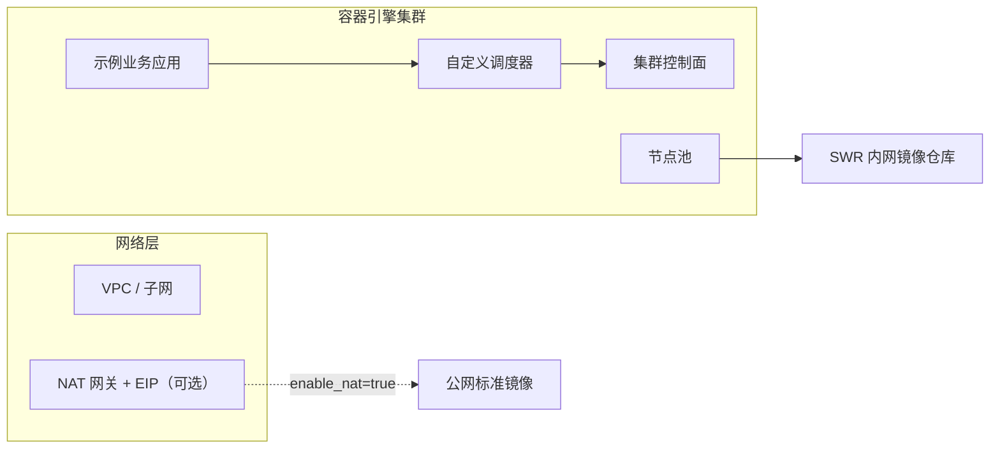

# 自定义调度器（装箱策略）华为云实践 / Custom Kubernetes Scheduler with Bin-Packing

[](LICENSE)
[](https://support.huaweicloud.com/intl/en-us/)
[](#)

> 在华为云容器引擎（CCE）上部署自定义 Kubernetes 调度器，采用 MostAllocated 装箱评分策略。
> Deploy a custom Kubernetes scheduler with the MostAllocated bin-packing score strategy on CCE.

---

## 1. 简介 / Overview [CRITICAL]

**中文**：本实践提供在云容器引擎（CCE）上运行自定义 Kubernetes 调度器的方案，采用 `MostAllocated` 装箱评分策略，提升节点资源利用率、降低碎片化，适用于批处理与短生命周期作业等场景。面向 DevOps 工程师、平台运维与后端开发，可作为参考架构与生产模板使用。

**English**: This reference architecture runs a custom Kubernetes scheduler on CCE with the `MostAllocated` bin-packing score strategy, improving node utilization and reducing fragmentation for batch and short-lived workloads. It targets DevOps engineers, platform operators, and backend developers as a reference architecture or production template.

### 核心能力

- 在托管 Kubernetes 集群上额外部署第二个调度器，不影响默认调度行为
- 通过 `KubeSchedulerConfiguration` 启用 `NodeResourcesFit` 的 `MostAllocated` 策略
- 业务 Pod 通过 `spec.schedulerName` 显式选择自定义调度器
- 提供 Helm 图表与静态清单两种交付形态，并附带可选监控配置

---

## 2. 目录 [MINOR]

- [1. 简介](#1-简介--overview-critical)
- [2. 目录](#2-目录-minor)
- [3. 架构图](#3-架构图-minor)
- [4. 方案亮点](#4-方案亮点-minor)
- [5. 涉及云服务](#5-涉及云服务-minor)
- [6. 前置条件](#6-前置条件-critical)
- [7. 快速开始](#7-快速开始-critical)
- [8. 分步部署](#8-分步部署-minor)
- [9. 使用方法 / 验证](#9-使用方法--验证-critical)
- [10. 清理资源](#10-清理资源-minor)
- [11. 详细说明](#11-详细说明-minor)
- [12. 依赖](#12-依赖-minor)
- [13. FAQ / 故障排除](#13-faq--故障排除-minor)
- [14. 贡献指南](#14-贡献指南-minor)
- [15. 许可证](#15-许可证-critical)
- [16. 联系方式](#16-联系方式-critical)
- [17. 创建者 / 维护者](#17-创建者--维护者-critical)

---

## 3. 架构图 [MINOR]

> 在云容器引擎集群中，以独立 Deployment 形式运行自定义调度器，业务 Pod 显式选择该调度器。



**关键组件说明**：
- 容器引擎集群（CCE）：托管 Kubernetes 集群，提供控制面与节点池
- 自定义调度器：第二个 `kube-scheduler` 实例，启用 MostAllocated 装箱策略
- 镜像仓库（SWR）：默认经内网拉取调度器与示例应用镜像，节点无需公网出口
- 公网出口（可选）：仅当 `enable_nat=true` 时创建 NAT 网关 + EIP，用于节点直连公网拉取镜像

---

## 4. 方案亮点 [MINOR]

- **提升节点利用率**：MostAllocated 策略优先填满已用资源高的节点，减少碎片化
- **业务无侵入**：仅需为 Pod 指定 `schedulerName`，不影响集群默认调度
- **高可用**：多副本 + leaderElection，避免单点
- **双形态交付**：同时提供 Helm 图表与静态清单，适配不同交付习惯

---

## 5. 涉及云服务 [MINOR]

| 服务 | 用途 | 备注 |
|---|---|---|
| 云容器引擎 CCE | 托管 Kubernetes 集群 | 运行调度器与业务负载 |
| 虚拟私有云 VPC | 网络隔离与子网规划 | 集群与节点所在网络 |
| NAT 网关 + EIP（可选） | 节点公网出口 | 仅 enable_nat=true 时创建，用于公网镜像拉取 |
| 安全组 | 节点网络访问控制 | 节点组出方向与安全互访 |
| 容器镜像仓库 SWR | 托管调度器与示例镜像 | 默认经内网拉取，节点无需公网 |

> **提示**：所有服务均可通过本仓库的 Terraform 一键创建；如需清理，请参见 [第 10 节「清理资源」](#10-清理资源-minor)。

> **资源规格与用量说明**：各服务的规格与部署用量说明见第 11 节「详细说明」。

---

## 6. 前置条件 [CRITICAL]

| 项 | 要求 | 说明 |
|---|---|---|
| **账号** | 已开通华为云账号并完成实名认证 | 个人/企业账号均可 |
| **权限** | 具备 VPC / CCE / SWR 等服务的创建权限（如需公网出口再加 NAT） | 建议 Tenant Administrator 或等效权限 |
| **Region** | 推荐 `cn-north-4` | 需与节点规格、镜像可售性一致 |
| **工具** | Terraform `>= 1.5.0`、kubectl、Helm `>= 3.0`（可选） | kubectl 版本需与集群 Kubernetes 版本匹配 |
| **凭据** | 访问密钥（AK/SK） | 运行时经环境变量提供，不写入文件 |

---

## 7. 快速开始 [CRITICAL]

```bash
# 1. 配置访问凭据（不写入任何文件）
export HW_ACCESS_KEY="<你的访问密钥>"
export HW_SECRET_KEY="<你的私密密钥>"

# 2. 编排云上底座
cd infra
cp terraform.tfvars.example terraform.tfvars
terraform init && terraform apply -auto-approve
cd ..

# 3. 获取 CCE kubeconfig 并指向本地
export KUBECONFIG=/path/to/your/kubeconfig
kubectl get nodes

# 3.5 将镜像同步至 SWR 内网（默认无需公网出口，apply 后再执行）
bash src/scripts/sync-images.sh

# 4. 部署自定义调度器（Kubernetes 1.25+ 清单）
kubectl apply -f src/manifests/custom-scheduler/cce-custom-scheduler.yaml

# 5. 部署示例业务应用（使用自定义调度器）
kubectl apply -f src/deployments/nginx-deployment.yaml
```

---

## 8. 分步部署 [MINOR]

1. **编排底座**：在 `infra/` 执行 `terraform init → plan → apply`，创建 VPC、子网、安全组、CCE 集群与节点池、SWR（默认不含 NAT；如需节点公网出口，将 `infra` 变量 `enable_nat` 设为 `true`）。
2. **获取凭证**：通过控制台或命令行获取 CCE kubeconfig，配置本地 kubectl。
3. **部署调度器**：
   - 静态清单：`kubectl apply -f src/manifests/custom-scheduler/cce-custom-scheduler.yaml`（1.25+）；1.24 使用 `cce-custom-scheduler-1.24.yaml`。
   - 或 Helm：`helm install custom-scheduler ./src/helm/custom-scheduler --namespace kube-system --set k8sVersion=1.29`。
4. **部署示例应用**：`kubectl apply -f src/deployments/nginx-deployment.yaml`。
5. **可选监控**：`kubectl apply -f src/manifests/monitoring/`。

---

## 9. 使用方法 / 验证 [CRITICAL]

### 验证 1：调度器组件运行正常

```bash
kubectl get pods -n kube-system -l component=scheduler,tier=control-plane
```

**预期**：2 个 Pod 处于 `Running` 状态。

### 验证 2：示例应用被自定义调度器接管

```bash
kubectl get pods -n nginx-test -o wide
kubectl get pod -n nginx-test <pod-name> -o jsonpath='{.spec.schedulerName}'
```

**预期**：Pod 处于 `Running`，且 `schedulerName` 为 `custom-k8s-scheduler`。

### 验证 3：装箱效果观察

```bash
kubectl top nodes
kubectl describe pod -n nginx-test <pod-name> | grep -A2 Scheduler
```

**预期**：Pod 落在已分配资源较高的节点，呈现装箱（bin-packing）特征。

---

## 10. 清理资源 [MINOR]

```bash
# 释放业务负载
kubectl delete -f src/deployments/nginx-deployment.yaml
kubectl delete -f src/manifests/custom-scheduler/cce-custom-scheduler.yaml

# 释放云上底座
cd infra && terraform destroy -auto-approve
```

> **避免资源残留**：`terraform destroy` 仅释放 Terraform state 中追踪的资源；控制台手动创建的资源需手动释放。

---

## 11. 详细说明 [MINOR]

### 工作流程

业务 Pod 在 `spec.schedulerName` 中指定自定义调度器名 → 该调度器实例依据 `KubeSchedulerConfiguration` 的 `MostAllocated` 策略为 Pod 挑选节点 → 节点资源向高占用集中，提升单节点利用率。

### 配置项（Terraform 变量）

| 变量 | 默认值 | 说明 |
|---|---|---|
| `region` | `cn-north-4` | 部署区域 |
| `project_name` | `custom-scheduler` | 资源命名前缀 |
| `node_flavor` | `s6.large.2` | 节点池计算规格 |
| `node_count` | `2`（验证可设 `1`） | 节点池初始节点数 |
| `swr_organization` | `custom-scheduler` | 镜像组织名 |
| `enable_nat` | `false` | 是否创建 NAT 网关 + EIP 提供节点公网出口 |
| `eip_bandwidth_size` | `5` | 仅 enable_nat=true 时生效：NAT 出口带宽（Mbit/s） |

### 配置项（Helm 变量）

| 变量 | 默认值 | 说明 |
|---|---|---|
| `k8sVersion` | `1.29` | 推导调度器镜像 tag |
| `schedulerName` | `custom-k8s-scheduler` | Pod 引用的调度器名 |
| `replicaCount` | `2` | 调度器副本数 |
| `monitoring.enabled` | `false` | 是否创建指标 Service / ServiceMonitor |

---

## 12. 依赖 [MINOR]

### 主要依赖

| 名称 | 版本 | 用途 |
|---|---|---|
| Terraform | `>= 1.5.0` | 基础设施编排 |
| huaweicloud Provider | `>= 1.96.0` | 华为云资源 |
| Helm | `>= 3.0` | 图表交付（可选） |
| kubectl | 与集群版本匹配 | 清单交付与验证 |

---

## 13. FAQ / 故障排除 [MINOR]

### Q1：部署时提示「权限不足」怎么办？

**A**：确认账号具备 VPC、CCE、SWR、NAT 等服务的创建权限，或至少包含对应子服务管理员权限。

### Q2：示例应用没有被自定义调度器接管？

**A**：检查 Pod 的 `spec.schedulerName` 是否设置为 `custom-k8s-scheduler`，且调度器 Pod 处于 `Running`。若调度器未就绪，Pod 会处于 `Pending`。

### Q3：节点拉取镜像失败？

**A**：本实践默认经 SWR 内网拉取镜像，无需公网。若失败，请核对镜像地址是否为 `swr.<区域>.myhuaweicloud.com/<组织>/...` 且 SWR 仓库存在对应 tag；可运行 `src/scripts/sync-images.sh` 重新同步。如确需公网拉取，请将 `enable_nat` 设为 `true` 并确保节点安全组出方向允许公网。

### 故障排查清单

| 现象 | 可能原因 | 排查方法 |
|---|---|---|
| 调度器 Pod `Pending` | 节点资源不足 / 安全组限制 | `kubectl describe pod` 查看事件 |
| 业务 Pod 不调度 | `schedulerName` 拼写错误 | 核对 Pod 与调度器名称 |
| 镜像拉取失败 | SWR 内网地址错误或仓库无该 tag | 核对镜像地址与 sync-images.sh 同步结果 |

---

## 14. 贡献指南 [MINOR]

欢迎提交 Issue 与 PR。请遵循以下流程：

1. **Issue**：描述问题 / 建议（含复现命令、预期 / 实际输出）。
2. **PR**：基于 `main` 分支新建 feature 分支；提交前运行 `terraform validate` 与门禁检查。
3. **Code Review**：由 zhangcheng123321 审核通过后合并。

---

## 15. 许可证 [CRITICAL]

本实践采用 **MIT No Attribution** 许可证发布。详见仓库根目录 [`LICENSE`](LICENSE) 文件。

```
MIT No Attribution

Copyright (c) Huawei Cloud

Permission is hereby granted, free of charge, to any person obtaining a copy
of this software... (no attribution required)
```

> 本实践基于 MIT 许可证（MIT No Attribution）调整发布，许可证变更明细随仓库提供。

---

## 16. 联系方式 [CRITICAL]

| 项 | 内容 |
|---|---|
| **联系方式** | 通过仓库 Issue 反馈 |

---

## 17. 创建者 / 维护者 [CRITICAL]

| 角色 | 账号 |
|-|-|
| **创建者** | zhangcheng123321 |
| **维护者** | zhangcheng123321 |
