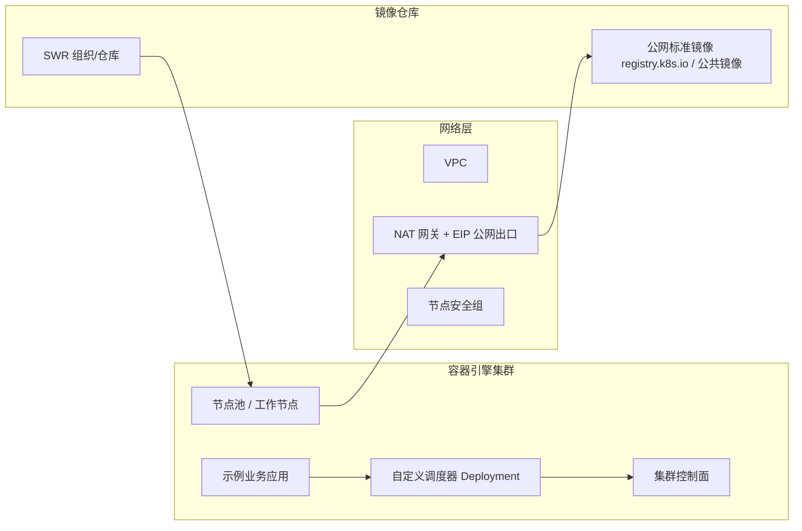

# 架构说明（Architecture）

> 本实践在华为云容器引擎（CCE）上部署一个自定义 Kubernetes 调度器，采用
> `MostAllocated` 装箱评分策略，提升节点资源利用率、降低碎片化，适用于批处理、
> 短生命周期作业等容易产生碎片化的业务场景。

---

## 1. 整体架构

---

## 2. 关键组件

| 组件 | 说明 |
|---|---|
| 容器引擎集群（CCE） | 托管式 Kubernetes 集群，提供控制面与节点池。集群类型为 VirtualMachine，容器网络模式为 vpc-router。 |
| 节点池 | 运行调度器与业务 Pod 的计算节点；节点操作系统为 Huawei Cloud EulerOS 2.0，规格默认 s6.large.2。 |
| 自定义调度器 | 以独立 Deployment 形式运行第二个 `kube-scheduler` 实例，启用 `NodeResourcesFit` 的 `MostAllocated` 评分策略，并将 Pod 按该调度器名调度。 |
| 公网出口（NAT + EIP） | 工作节点经 SNAT 访问公网，拉取标准公开镜像（如 `registry.k8s.io/kube-scheduler`、`nginx`）。 |
| 镜像仓库（SWR） | 软工仓库（SoftWare Repository），用于托管用户自定义业务镜像。 |
| 安全组 | 节点组出方向全开、组内互访，保证集群网络通信与镜像拉取。 |

---

## 3. 调度原理

默认 `kube-scheduler` 的 `LeastAllocated` 策略会把 Pod 打散到各节点，造成节点
利用率偏低、缩容不及时。本实践额外部署一个调度器，对 CPU、内存采用
`MostAllocated`（优先填满已用资源最多的节点），从而：

- 提高单节点资源利用率，减少运行中的节点数量；
- 让短生命周期作业尽量集中在少数节点，便于及时缩容；
- 业务 Pod 通过 `spec.schedulerName` 显式选择该调度器，不影响集群默认调度行为。

调度器以 `KubeSchedulerConfiguration` 声明 `MostAllocated` 策略，并保留
`NodeResourcesFit`、多扩展点（multiPoint）等标准插件配置；通过 `leaderElection`
保证多副本高可用。

---

## 4. 镜像策略

| 镜像 | 来源 | 说明 |
|---|---|---|
| `registry.k8s.io/kube-scheduler` | 标准 Kubernetes 镜像 | 与任何标准 Kubernetes 发行版兼容，版本需与目标集群 Kubernetes 版本一致。 |
| `nginx` | 公共镜像（Docker Hub 官方） | 示例业务应用镜像，用于验证自定义调度器效果。 |
| 自定义业务镜像 | SWR | 用户构建的业务镜像可推送至 SWR 后在集群内引用。 |

> 工作节点通过 NAT 公网出口直接拉取公开镜像；如需完全内网闭环，可将镜像同步
> 至 SWR 后改用 SWR 内网地址。

---

## 5. 目录与资源关系

- `infra/`：Terraform 编排的云上底座（VPC、子网、NAT、安全组、CCE 集群与节点池、SWR）。
- `src/helm/custom-scheduler/`：自定义调度器的 Helm 图表（Deployment、ConfigMap、RBAC、可选监控）。
- `src/manifests/custom-scheduler/`：等效的静态清单（KubeSchedulerConfiguration v1，及 1.24 的 v1beta2 变体）。
- `src/manifests/monitoring/`：调度器指标 Service 与 ServiceMonitor。
- `src/deployments/`：使用自定义调度器的示例业务应用。
